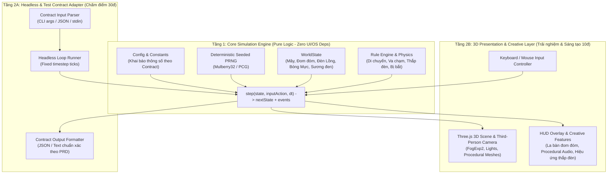
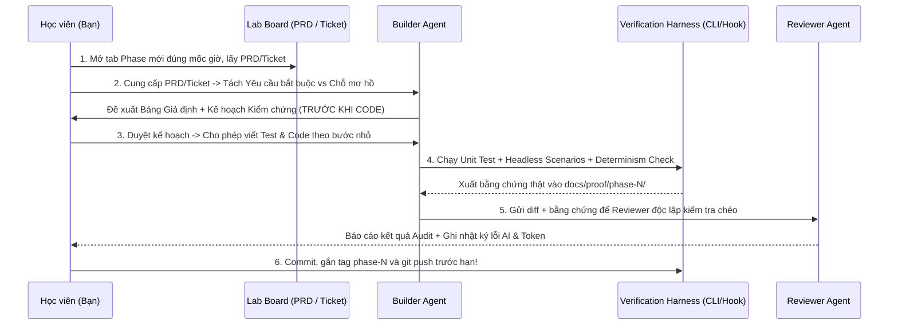

# KẾ HOẠCH XÂY DỰNG DỰ ÁN (MASTER EXECUTION PLAN)
# Day 12 — AI SDLC: Đảo Đèn Lồng

> **Học viên:** Đỗ Đắc Duy · **MSSV:** `2A202603604` · **Lớp:** `K5-L3A`
> **Hình thức:** Cá nhân (1 người / 1 MSSV / 1 repo GitHub public)
> **Thời lượng Lab:** 4 giờ · **Số giai đoạn:** 4 Phases (`phase-1` -> `phase-4`) + Release `v1.0.0` + Video Demo `.mp4` (< 5 phút)
> **Lab Board & Trợ giảng:** [Đảo Đèn Lồng Lab](https://claude.ai/artifact/Q1RYyv1dxjUczzCbd2ZnoW)

---

## 1. Tổng quan Dự án & Triết lý Thực thi

### 1.1. Bối cảnh sản phẩm
**Đảo Đèn Lồng** là một trò chơi **3D góc nhìn thứ ba (Third-person 3D Game)**. Người chơi điều khiển nhân vật **Mây** (người giữ đèn nhỏ tuổi) di chuyển trên đảo, thu thập **đom đóm** để thắp sáng lại các **Đèn Lồng Lớn**, đồng thời né tránh **Bóng Mực** ẩn hiện trong màn **sương đen**.

Dự án được phát triển qua **4 phase liên tiếp** trong vòng **4 giờ**:
- **Phase 1 (`0h00 – 1h00`):** Nhận `PRD-0` (mô tả tổng quát, có những chỗ mơ hồ có chủ đích) + `Test Contract`. Nộp tag `phase-1`.
- **Phase 2 (`1h00 – 2h00`):** Nhận `Ticket-02` (mở rộng tính năng, làm rõ hoặc điều chỉnh giả định). Nộp tag `phase-2`.
- **Phase 3 (`2h00 – 2h30`):** Nhận `Ticket-03` (thay đổi yêu cầu có thể **thay thế luật cũ** trong thời gian ngắn 30 phút). Nộp tag `phase-3`.
- **Phase 4 (`2h30 – 4h00`):** Nhận `Ticket-04` (đo đạc hiệu năng/ổn định theo ngưỡng cụ thể, đóng gói bản phát hành, quay video demo). Nộp tag `phase-4` + GitHub Release `v1.0.0` + Video `.mp4`.

### 1.2. Ba nguyên tắc sống còn
1. **Đúng yêu cầu & Kiểm chứng được > Phức tạp & Đẹp:** Đồ họa vượt yêu cầu không được cộng điểm. Mọi tính năng cốt lõi phải tuân thủ tuyệt đối **Test Contract (chế độ Headless)** và có **bằng chứng thật khớp với mã nguồn tại đúng tag**.
2. **Kiến trúc Headless-First & Deterministic 100%:** Logic mô phỏng game (Core Simulation) phải tách biệt hoàn toàn khỏi tầng hiển thị 3D (Renderer/Window) ngay từ dòng code đầu tiên để chạy được bằng CLI trên máy chấm **macOS / Linux** mà không cần GPU hay cửa sổ giao diện.
3. **Kỷ luật Thời gian & Quota Token:** Hết giờ mỗi phase phải chốt bằng chứng trung thực, gắn tag và push ngay. Giữ ngữ cảnh gọn, lập kế hoạch kiểm chứng trước khi cho AI viết code.

---

## 2. Bản đồ Tối ưu hóa Điểm số theo Rubric (100/100 Điểm)

| Hạng mục | Điểm | Tiêu chí chi tiết | Chiến lược & Sản phẩm bàn giao (Deliverables) |
|---|---:|---|---|
| **A. Test tự động ẩn** | **30** | Giảng viên chạy kịch bản ẩn qua chế độ Headless theo Test Contract ở từng tag (`phase-1`..`4`), gồm cả kiểm tra hồi quy phase trước. | - Tách `src/core/` (thuần logic, không phụ thuộc DOM/WebGL/Window).<br>- Dùng bộ sinh số ngẫu nhiên có hạt giống (**Seeded PRNG**) & bước thời gian cố định (**Fixed `dt`**).<br>- Viết CLI adapter tuân thủ chính xác 100% schema Input/Output của Test Contract.<br>- Trước khi gắn tag mới, luôn chạy lại toàn bộ regression suite của các phase trước. |
| **B. Kiểm chứng & bằng chứng** | **20** | 1. Truy vết yêu cầu -> bằng chứng (5đ)<br>2. Bằng chứng thật, khớp tag (4đ)<br>3. Test & scenario tự viết, chạy 1 lệnh (4đ)<br>4. Tự động hóa kiểm chứng / CI (3đ)<br>5. Agent tự kiểm chứng + ngăn kết thúc khi test đỏ + Reviewer độc lập (4đ) | - Bảng truy vết `docs/proof/phase-N/proof.md` cho mọi yêu cầu (ghi rõ `VERIFIED` / `CHƯA ĐẠT` trung thực).<br>- Lệnh duy nhất chạy toàn bộ unit tests + headless scenarios + determinism check.<br>- GitHub Actions CI (`.github/workflows/verify.yml`) + Git Hook (`.githooks/pre-commit`).<br>- Script `scripts/verify_phase.*` tự động chạy game headless và chụp log thực tế.<br>- Áp dụng quy trình **Builder -> Reviewer độc lập** (subagent hoặc 2 pha tách biệt của `ai20k-universal-study-review`). |
| **C. Quy trình SDLC & Harness AI** | **15** | 1. Hiểu & làm rõ yêu cầu, giả định, AC (4đ)<br>2. Xử lý thay đổi yêu cầu & cập nhật test cũ có lý do (3đ)<br>3. File hướng dẫn agent ngắn gọn, tiến hóa qua các phase (3đ)<br>4. Skill / Hook / Công cụ hữu ích (3đ)<br>5. Git commits nhỏ, rõ, đủ 4 tag & Release `v1.0.0` (2đ) | - File `docs/notes/assumptions-and-changes.md` ghi giả định + bảng thay đổi thiết kế/test khi sang Phase 2, 3, 4.<br>- `AGENTS.md` (< 50 dòng) được cập nhật ở mỗi phase (lưu vết trong `git log`).<br>- Custom Skill `.agents/skills/headless-verifier/SKILL.md` + Pre-commit Hook chặn commit khi test đỏ hoặc lộ secret.<br>- Commit atomic theo chuẩn `feat(phase1): ...`, `test(phase1): ...`, `docs(phase1): ...`. |
| **D. Evaluation & Retro** | **10** | 1. Đánh giá từng phase (4đ)<br>2. Phân tích lỗi của AI & cách chỉnh harness (2đ)<br>3. Dùng token có cân nhắc & ước tính chi phí (2đ)<br>4. Retro tổng kết dự án (2đ) | - File `docs/notes/ai-log-and-retro.md` cập nhật ngay cuối mỗi phase:<br>  + Bảng đánh giá kết quả phase & kiểm tra hồi quy.<br>  + Nhật ký "AI Failure Modes" (AI bịa yêu cầu, sửa sai file, viết test yếu -> đã sửa `AGENTS.md`/hook thế nào).<br>  + Bảng thống kê ước tính Token / Chi phí mỗi phase & các kỹ thuật tiết kiệm token.<br>  + Retro cuối dự án (số liệu, bài học, điều sẽ làm khác). |
| **E. Hiệu năng & ổn định** | **10** | Đo bằng lệnh theo tài liệu phase trên máy chấm chung theo ngưỡng yêu cầu. | - Tối ưu vòng lặp simulation (O(1) hoặc O(N) nhẹ, không cấp phát bộ nhớ thừa trong tick loop, tránh memory leak).<br>- Tối ưu render 3D (dùng hình khối cơ bản/low-poly, instancing nếu nhiều đom đóm, giới hạn shadow/shader nặng).<br>- Script benchmark tự động xuất thời gian chạy (ms/tick, FPS, RAM) kèm thông số máy vào `docs/proof/phase-4/perf.json`. |
| **F. Chất lượng sản phẩm & Sáng tạo** | **10** | - 6đ: Đúng yêu cầu, chơi được mượt mà.<br>- 4đ: Sáng tạo gọn, chạy ổn, **không phá Test Contract**, có mục "Sáng tạo của tôi" trong README kèm bằng chứng. | - Điều khiển góc nhìn thứ 3 trực quan, HUD rõ ràng, camera theo sau Mây mượt mà.<br>- **Sáng tạo an toàn:** Đặt các tính năng sáng tạo (hiệu ứng ánh sáng ấm khi thắp đèn, la bàn/tia sáng dẫn đường tới Đèn Lồng gần nhất, âm thanh WebAudio procerudal, hiệu ứng sương tan) ở tầng Presentation hoặc sau cờ tùy chọn để **tuyệt đối không làm thay đổi output của chế độ Headless**. |
| **G. Video demo** | **5** | Dưới 5 phút, `.mp4`, xem được không cần đăng nhập; có chơi thử + bằng chứng test đạt + đo hiệu năng. | - Quay màn hình < 5 phút, nén bằng `ffmpeg` ra `.mp4` (< 50MB).<br>- Đính kèm vào GitHub Release `v1.0.0` **và** lưu tại `docs/demo/demo.mp4`, dẫn link ngay dòng đầu tiên của `README.md`. |

---

## 3. Kiến trúc Kỹ thuật & Chiến lược "Headless-First"

### 3.1. Lựa chọn Công nghệ (Tech Stack Đề xuất)

Do bài lab phát triển trên máy cá nhân (Windows) nhưng **giảng viên chấm tự động trên macOS hoặc Linux** và yêu cầu **cài đặt + chạy trong tối đa 3 lệnh**, kiến trúc cần đảm bảo tính tương thích đa nền tảng tuyệt đối:

#### Phương án Chủ lực (Khuyến nghị #1): **TypeScript/JavaScript (Node.js + Three.js + Vite)**
- **Tại sao tối ưu nhất cho Lab này?**
  1. **100% Đa nền tảng (Windows / macOS / Linux):** Mọi máy chấm macOS/Linux có Node.js đều chạy `npm ci && npm test` hoặc `node src/headless/cli.mjs` với kết quả số học IEEE-754 **giống hệt nhau 100%**.
  2. **Tách biệt Headless cực sạch:** Tầng `src/core/` viết bằng JS/TS thuần (Zero Dependencies), chạy trực tiếp bằng `node` với tốc độ hàng chục nghìn ticks/giây mà không cần trình duyệt hay Xvfb/GPU.
  3. **3D góc nhìn thứ ba nhanh & đẹp:** `Three.js` dựng nhân vật Mây, đảo, đom đóm phát sáng (PointLight/Emissive), Đèn Lồng Lớn, Bóng Mực và sương đen (`THREE.FogExp2`) chỉ trong vài chục dòng code, không cần nạp asset 3D ngoài nặng nề.
  4. **Đóng gói Release `v1.0.0` siêu gọn:** `npm run build` xuất ra thư mục web tĩnh `dist/` (kèm script chạy nhanh), đáp ứng hoàn hảo yêu cầu *"file thực thi, thư mục web tĩnh hoặc Docker kèm hướng dẫn"* của `SUBMISSION.md`.
  5. **3 lệnh chuẩn trong README:**
     ```bash
     npm install
     npm run test:headless
     npm start
     ```

*(Phương án Dự phòng nếu PRD-0 yêu cầu ngôn ngữ cụ thể như Python: dùng **Python 3.10+**, `src/core/` viết bằng Python thuần chỉ dùng thư viện chuẩn `math`, `json`, `dataclasses` để chạy `python3 -m src.headless`, còn tầng hiển thị 3D dùng `ursina` / `panda3d` / `pygame+moderngl` hoặc Web-bridge).*

### 3.2. Sơ đồ Kiến trúc Tách lớp (Hexagonal / Clean Simulation Architecture)



### 3.3. Thiết kế Đảm bảo Tính Tất Định (Determinism Guarantee)
- **Cấm tuyệt đối** dùng `Math.random()` hay `Date.now()` / `performance.now()` bên trong `src/core/`.
- Mọi yếu tố ngẫu nhiên (vị trí spawn đom đóm, hướng tuần tra của Bóng Mực) bắt buộc đi qua `SeededRNG(seed)` truyền vào lúc khởi tạo `WorldState`.
- Mọi chuyển động trong `src/core/` tính theo bước thời gian cố định `dt` (hoặc theo từng `tick` quy định trong Test Contract), làm tròn số thực nhất quán nếu Test Contract yêu cầu so khớp chuỗi/số thập phân.

---

## 4. Cấu trúc Thư mục Chuẩn của Dự án

Cấu trúc này được thiết kế để người chấm tìm thấy ngay mọi hạng mục yêu cầu trong `SUBMISSION.md` mục 3:

```text
K5-L3A-DAY12-DoDacDuy-2A202603604-AI-SDLC-Dao-Den-Long/
├── README.md                        # Link video demo ở dòng đầu, <= 3 lệnh chạy, cách chạy headless, mục "Sáng tạo của tôi"
├── PLAN.md                          # Kế hoạch tổng thể dự án (file này)
├── AGENTS.md                        # Hướng dẫn ngắn gọn cho AI Agent (< 50 dòng, cập nhật qua từng phase)
├── CREDITS.md                       # Nguồn asset, âm thanh procedural, công cụ AI sử dụng
├── LICENSE                          # Giấy phép MIT
├── CHANGELOG.md                     # Lịch sử thay đổi qua 4 tag: phase-1, phase-2, phase-3, phase-4, v1.0.0
├── package.json                     # Khai báo scripts: start, build, test, headless, verify, bench
├── .gitignore                       # Chặn node_modules, .env, file rác (KHÔNG chặn .agents/ hay docs/proof/)
├── .github/
│   └── workflows/
│       └── verify.yml               # Tự động hóa kiểm chứng (CI chạy unit test + headless + determinism mỗi lần push)
├── .githooks/
│   └── pre-commit                   # Hook chặn commit khi test đỏ hoặc phát hiện lộ API key / .env
├── .agents/
│   └── skills/
│       └── phase-verifier/
│           └── SKILL.md             # Custom Skill cho Agent tự chạy game headless, kiểm tra determinism và lưu bằng chứng
├── src/
│   ├── core/                        # LOGIC THUẦN (100% deterministic, không import Three.js hay DOM)
│   │   ├── config.js                # Các hằng số và thông số tự chọn được khai báo theo Test Contract
│   │   ├── rng.js                   # Bộ sinh số ngẫu nhiên có seed (Deterministic PRNG)
│   │   ├── entities.js              # Thực thể: Mây (Player), Firefly, GreatLantern, InkShadow, BlackFog
│   │   ├── simulation.js            # Hàm khởi tạo và hàm step(state, input, dt)
│   │   └── contract.js              # Xử lý dữ liệu đầu vào/đầu ra theo đúng đặc tả Test Contract
│   ├── headless/
│   │   └── cli.js                   # Điểm vào chạy chế độ Headless từ dòng lệnh
│   └── client/                      # TẦNG HIỂN THỊ 3D & SÁNG TẠO (không ảnh hưởng đầu ra headless)
│       ├── index.html               # Giao diện game + HUD
│       ├── main.js                  # Vòng lặp render 3D góc nhìn thứ ba (Three.js)
│       ├── audio.js                 # Âm thanh WebAudio tự tổng hợp (Procedural Audio - không lo bản quyền)
│       └── creative.js              # Các tính năng trong mục "Sáng tạo của tôi"
├── tests/
│   ├── unit/                        # Unit test cho từng cơ chế (di chuyển, gom đom đóm, thắp đèn, Bóng Mực, sương đen)
│   ├── scenarios/                   # Các kịch bản đầu vào (.json / .txt) và kết quả kỳ vọng
│   └── run_tests.js                 # Trình chạy toàn bộ unit test + scenario + determinism check
├── scripts/
│   ├── verify_phase.js              # Script tự động chạy kiểm chứng và xuất bằng chứng thực tế ra docs/proof/phase-N/
│   └── benchmark.js                 # Script đo hiệu năng & ổn định (Phase 4)
└── docs/
    ├── notes/
    │   ├── assumptions-and-changes.md # Giả định cho chỗ mơ hồ mỗi phase & Lý do thay đổi thiết kế/test khi đổi luật
    │   └── ai-log-and-retro.md        # Nhật ký dùng AI, phân tích lỗi AI, thống kê Token/Chi phí, Đánh giá từng phase & Retro
    ├── proof/
    │   ├── phase-1/                 # Bằng chứng Phase 1 (proof.md, test-output.txt, determinism-diff.txt, screenshots/)
    │   ├── phase-2/                 # Bằng chứng Phase 2
    │   ├── phase-3/                 # Bằng chứng Phase 3
    │   └── phase-4/                 # Bằng chứng Phase 4 + kết quả đo hiệu năng (perf-report.json)
    └── demo/
        └── demo.mp4                 # Video demo dưới 5 phút (hoặc đính kèm Release v1.0.0)
```

---

## 5. Thiết kế Hệ thống Harness AI & Tự động hóa Kiểm chứng

Để đạt tối đa **15/15 điểm Mục C (Quy trình SDLC & Harness AI)** và **20/20 điểm Mục B (Kiểm chứng & Bằng chứng)**, hệ thống Harness được thiết kế gọn, thực chất và có lịch sử tiến hóa rõ ràng:

### 5.1. `AGENTS.md` (Ngắn gọn, cập nhật qua từng Phase)
- **Dung lượng:** Giữ dưới 50 dòng để tiết kiệm context token ở mọi lượt gọi agent.
- **Nội dung cốt lõi:**
  1. Lệnh chuẩn: `npm test` (unit + headless scenarios), `npm run headless -- <args>`, `npm run verify -- --phase <N>`.
  2. Ranh giới kiến trúc bất khả xâm phạm: `src/core/` tuyệt đối không dùng `Math.random()`, `Date.now()`, `window`, `document`, hay `three`.
  3. Quy tắc kiểm chứng: Không bao giờ báo cáo "đã xong" nếu chưa chạy `npm run verify` và kiểm tra file log trong `docs/proof/phase-N/`.
  4. Quy tắc thay đổi yêu cầu: Khi luật game thay đổi ở Phase 2/3/4, không xóa hoặc skip test cũ một cách âm thầm; phải ghi rõ lý do vào `docs/notes/assumptions-and-changes.md` và chú thích trong file test.
  5. Mục `## Harness Evolution Log` ở cuối `AGENTS.md`: Ghi 1-2 dòng ở mỗi phase về quy tắc mới được bổ sung sau khi phát hiện lỗi của AI.

### 5.2. Custom Skill: `.agents/skills/phase-verifier/SKILL.md`
- Định nghĩa quy trình chuẩn để Agent tự kiểm chứng sau khi code xong một tính năng:
  1. Chạy bộ Unit Tests.
  2. Chạy các kịch bản Headless (`tests/scenarios/phase-N-*.json`).
  3. Chạy kiểm tra tính tất định (**Determinism Test**): Chạy cùng một kịch bản 2 lần độc lập (`run1.out` và `run2.out`), so khớp byte-for-byte (`SHA-256` hoặc `diff`).
  4. Xuất toàn bộ raw stdout/stderr, mã thoát (exit code), hash và timestamp vào `docs/proof/phase-N/verification-report.json` và cập nhật bảng truy vết `docs/proof/phase-N/proof.md`.

### 5.3. Verification Gate & Git Hook (`.githooks/pre-commit`)
- Ngăn chặn lỗi con người và lỗi AI trước khi commit/tag:
  1. Quét tìm chuỗi nhạy cảm (`API_KEY`, `sk-`, `ghp_`, file `.env`) -> Nếu có, chặn commit ngay lập tức (tuân thủ `RULES.md` mục 9).
  2. Chạy nhanh `npm test` -> Nếu có bất kỳ test nào đỏ (`exit code != 0`), chặn commit và yêu cầu sửa code (đáp ứng tiêu chí *"có cơ chế ngăn kết thúc khi test đỏ"* trong `RUBRIC.md` mục 2).

### 5.4. Cơ chế Đánh giá Độc lập (Builder vs. Reviewer)
- Đáp ứng tiêu chí *"việc đánh giá do người hoặc agent khác người đã viết"* (`RUBRIC.md` mục 2):
- Trong mỗi phase, sau khi **Builder Agent** hoàn thành code và sinh bằng chứng, kích hoạt **Reviewer Subagent** (hoặc pha Review độc lập theo `ai20k-universal-study-review`) chỉ đọc `PRD/Ticket`, `git diff`, và chạy lại lệnh kiểm chứng để rà soát lỗi tiềm ẩn trước khi gắn tag.

---

## 6. Quy trình SDLC 6 Bước cho Mỗi Phase (Vòng lặp Chuẩn)



---

## 7. Lộ trình Thực thi Chi tiết theo 4 Giờ & 6 Checkpoints

### Checkpoint 0: Chuẩn bị (`0h00 – 0h10` | ~10 phút)
**Mục tiêu:** Sẵn sàng toàn bộ khung dự án, công cụ, harness và môi trường trước hoặc ngay đầu Phase 1.

- [ ] **Kiểm tra tên Repo & Quyền truy cập (`SUBMISSION.md` mục 1):**
  - Xác nhận tên repo trên GitHub đúng chuẩn: `K5-L3A-DAY12-DoDacDuy-2A202603604-AI-SDLC-Dao-Den-Long` (hoặc giữ nguyên tên repo do BTC cấp nếu Coach yêu cầu, kiểm tra chế độ **Public**).
- [ ] **Khởi tạo bộ khung thư mục & Harness v1:**
  - Tạo cấu trúc thư mục `src/core/`, `src/headless/`, `src/client/`, `tests/`, `scripts/`, `docs/notes/`, `docs/proof/`.
  - Tạo `AGENTS.md` (phiên bản v1), `.agents/skills/phase-verifier/SKILL.md`, `.githooks/pre-commit`, `.github/workflows/verify.yml`.
  - Tạo `LICENSE` (MIT) và khung `CREDITS.md`, `CHANGELOG.md`.
- [ ] **Chạy thử "Hello 3D & Headless":**
  - Xác nhận lệnh chạy headless CLI hoạt động tốt và cảnh 3D cơ bản hiển thị được trên trình duyệt.
- [ ] **Kiểm tra Lab Board:**
  - Đăng nhập `claude.ai`, mở [Đảo Đèn Lồng Lab](https://claude.ai/artifact/Q1RYyv1dxjUczzCbd2ZnoW), mở tab Phase 1.

---

### Checkpoint 1: Phase 1 — `PRD-0` & `Test Contract` (`0h10 – 1h00` | Hạn tag `phase-1`: trước mốc `1h00`)
**Mục tiêu:** Xây dựng bản chơi được đầu tiên + chế độ Headless tuân thủ tuyệt đối Test Contract từ mô tả tổng quát `PRD-0`.

1. **Phút 10 – 18 (Đọc `PRD-0`, Giả định & Kế hoạch Kiểm chứng):**
   - Đọc kỹ `PRD-0` và `Test Contract`.
   - Tách rõ:
     - **Bắt buộc chính xác 100%:** Cú pháp lệnh chạy headless, định dạng file/stdin đầu vào, định dạng JSON/stdout đầu ra, tên các trường khai báo thông số, quy tắc seed/tick.
     - **Chỗ mơ hồ cần giả định:** Tốc độ của Mây, bán kính thu thập đom đóm, số đom đóm cần để thắp 1 Đèn Lồng Lớn, tốc độ/tầm nhìn của Bóng Mực, ảnh hưởng của sương đen, kích thước bản đồ.
   - Ghi toàn bộ giả định và con số tự chọn vào `docs/notes/assumptions-and-changes.md` và khai báo trong `src/core/config.js` đúng yêu cầu contract.
2. **Phút 18 – 23 (Thiết kế Test & Scenario trước khi code):**
   - Định nghĩa các unit test và ít nhất 3–5 kịch bản headless cơ bản:
     - `S1_move_and_collect`: Mây di chuyển và gom đom đóm.
     - `S2_light_great_lantern`: Gom đủ đom đóm và thắp sáng Đèn Lồng Lớn.
     - `S3_ink_shadow_hazard`: Tương tác/né Bóng Mực trong sương đen (hoặc bị bắt/mất đom đóm theo luật).
     - `S4_determinism`: Chạy 2 lần cùng seed + cùng chuỗi input -> output trùng khớp 100%.
3. **Phút 23 – 45 (Xây dựng theo bước nhỏ):**
   - **Bước 3a (Core & Headless - Ưu tiên số 1):** Hoàn thiện `src/core/` và `src/headless/cli.js`. Chạy pass toàn bộ kịch bản headless theo đúng Test Contract.
   - **Bước 3b (3D Third-Person Client):** Kết nối `src/client/` vào `src/core/`. Dựng cảnh đảo 3D, nhân vật Mây góc nhìn thứ ba, đom đóm phát sáng, Đèn Lồng Lớn, Bóng Mực, sương đen và HUD hiển thị trạng thái.
4. **Phút 45 – 55 (Kiểm chứng thực tế & Lưu bằng chứng):**
   - Chạy `npm run verify -- --phase 1` để lưu output thật vào `docs/proof/phase-1/`.
   - Chụp ảnh màn hình 3D đang chơi lưu vào `docs/proof/phase-1/`.
   - Điền bảng truy vết `docs/proof/phase-1/proof.md` (mỗi yêu cầu chính của `PRD-0` -> cách kiểm chứng -> file bằng chứng -> kết quả).
5. **Phút 55 – 60 (Đánh giá nhanh, Tag `phase-1` & Push):**
   - Ghi đánh giá Phase 1, lỗi AI (nếu có) và ước tính token vào `docs/notes/ai-log-and-retro.md`.
   - Commit toàn bộ mã nguồn + bằng chứng, gắn tag và đẩy lên GitHub:
     ```bash
     git add -A && git commit -m "feat(phase-1): complete PRD-0 core simulation, 3D view, headless contract and proof"
     git tag phase-1
     git push origin main --tags
     ```

---

### Checkpoint 2: Phase 2 — `Ticket-02` (`1h00 – 2h00` | Hạn tag `phase-2`: trước mốc `2h00`)
**Mục tiêu:** Tiếp nhận yêu cầu mở rộng từ `Ticket-02`, tích hợp tính năng mới mà không làm hỏng các tính năng của Phase 1.

1. **Phút 00 – 10 (Phân tích `Ticket-02` & Đối chiếu Giả định Phase 1):**
   - Đọc `Ticket-02` trên Lab Board.
   - Kiểm tra xem `Ticket-02` có làm rõ hoặc thay đổi giả định nào của Phase 1 không -> Cập nhật ngay vào `docs/notes/assumptions-and-changes.md`.
   - Lập kế hoạch kiểm chứng (unit test + scenario mới) cho mọi yêu cầu trong `Ticket-02` **trước khi sửa code**.
2. **Phút 10 – 15 (Rà soát & Nâng cấp Harness):**
   - Xem ở Phase 1 AI có mắc lỗi nào không (ví dụ: sai lệch định dạng số thực, quên cập nhật config export, v.v.).
   - Cập nhật `AGENTS.md` (v2) hoặc thêm rule vào script kiểm tra để chặn lỗi đó tái diễn.
3. **Phút 15 – 42 (Xây dựng tính năng Phase 2 theo commit nhỏ):**
   - Mở rộng `src/core/`, cập nhật `src/headless/` (nếu contract bổ sung trường mới) và cập nhật `src/client/` 3D.
4. **Phút 42 – 54 (Kiểm chứng Mới + Kiểm chứng Hồi quy Phase 1):**
   - Chạy toàn bộ test mới của Phase 2 **VÀ** toàn bộ test/scenario của Phase 1.
   - Nếu có test Phase 1 bị thay đổi do `Ticket-02` yêu cầu, sửa test đó và ghi rõ lý do vào `docs/notes/assumptions-and-changes.md`.
   - Xuất bằng chứng thật vào `docs/proof/phase-2/proof.md`.
5. **Phút 54 – 60 (Nhật ký AI, Tag `phase-2` & Push):**
   - Cập nhật đánh giá Phase 2 + token log.
   - Commit, gắn tag và push trước mốc 2h00:
     ```bash
     git tag phase-2
     git push origin main --tags
     ```

---

### Checkpoint 3: Phase 3 — `Ticket-03` (`2h00 – 2h30` | Chỉ 30 phút! Hạn tag `phase-3`: trước mốc `2h30`)
**Mục tiêu:** Xử lý nhanh và chuẩn xác một thay đổi yêu cầu có tính chất **thay thế luật cũ (Rule Replacement)** trong khung thời gian 30 phút.

> **Chiến thuật cho 30 phút của Phase 3:** Không sa đà vào làm đẹp giao diện. Dồn 100% sự tập trung vào việc cập nhật đúng logic trong `src/core/`, quản lý minh bạch các test cũ bị ảnh hưởng, và xuất đủ bằng chứng khớp tag.

1. **Phút 00 – 06 (Xác định Luật Cũ bị Thay thế & Phân tích Tác động):**
   - Đọc `Ticket-03`, lập danh sách ngay:
     - Luật nào ở Phase 1 / Phase 2 bị thay thế?
     - Những hàm nào trong `src/core/` cần sửa?
     - Những test/scenario cũ nào sẽ bị **sai** theo luật mới?
   - Ghi ngay 1 đoạn ngắn giải thích **Thay đổi thiết kế thế nào và vì sao** vào `docs/notes/assumptions-and-changes.md` (ăn trọn 3đ tiêu chí *"Xử lý thay đổi yêu cầu"* trong Rubric C).
2. **Phút 06 – 18 (Cập nhật Core Logic & Xử lý Test Cũ Có Lý Do):**
   - Cập nhật logic trong `src/core/` và `src/client/`.
   - Với các test cũ bị luật mới làm sai: **Sửa lại theo luật mới hoặc đánh dấu deprecated kèm chú thích lý do rõ ràng** (tuyệt đối không xóa/tắt âm thầm).
   - Viết thêm test/scenario mới kiểm chứng luật của `Ticket-03`.
3. **Phút 18 – 26 (Chạy Kiểm chứng & Lưu Bằng chứng Phase 3):**
   - Chạy `npm run verify -- --phase 3`. Đảm bảo 100% test còn hiệu lực đều PASS và giữ nguyên tính tất định.
   - Lưu bằng chứng vào `docs/proof/phase-3/proof.md`.
4. **Phút 26 – 30 (Cập nhật Harness/Log, Tag `phase-3` & Push):**
   - Cập nhật nhanh `AGENTS.md` (nếu cần) và `docs/notes/ai-log-and-retro.md`.
   - Commit, gắn tag và push trước mốc 2h30:
     ```bash
     git tag phase-3
     git push origin main --tags
     ```

---

### Checkpoint 4: Phase 4 — `Ticket-04`, Đo Hiệu năng, Sáng tạo & Release `v1.0.0` (`2h30 – 3h45` | 75 phút)
**Mục tiêu:** Hoàn thiện các yêu cầu của `Ticket-04`, thực hiện phép đo hiệu năng/ổn định theo số đo cụ thể, hoàn tất mục "Sáng tạo của tôi", chuẩn hóa README <= 3 lệnh, gắn tag `phase-4` và phát hành Release `v1.0.0`.

1. **Phút 00 – 20 (Thực hiện Yêu cầu `Ticket-04` & Đo Hiệu năng/Ổn định - 10đ Mục E):**
   - Đọc kỹ các ngưỡng đo đạc cụ thể trong `Ticket-04` (ví dụ: tốc độ chạy headless N nghìn ticks/giây, thời gian phản hồi mỗi tick, bộ nhớ tiêu thụ, FPS, hoặc chạy soak test dài hạn không lỗi).
   - Viết/cập nhật `scripts/benchmark.js` theo đúng lệnh đo yêu cầu trong tài liệu phase.
   - Chạy đo thực tế và lưu kết quả kèm **cấu hình máy** (OS, CPU, RAM, Node/Runtime version) vào `docs/proof/phase-4/perf-report.json` và `docs/proof/phase-4/proof.md`.
2. **Phút 20 – 40 (Hoàn thiện Trải nghiệm 3D & Mục "Sáng tạo của tôi" - 10đ Mục F):**
   - Kiểm tra trải nghiệm chơi thực tế: điều khiển Mây mượt, camera góc nhìn thứ ba rõ ràng, dễ quan sát đom đóm, Đèn Lồng Lớn và Bóng Mực.
   - Bổ sung 2–3 điểm sáng tạo **gọn, chạy ổn định, và nằm hoàn toàn ở tầng hiển thị / tùy chọn để không làm thay đổi đầu ra Headless**:
     1. *Tia sáng dẫn đường / La bàn Đom đóm (Lantern Pulse):* Khi Mây gom đủ đom đóm, một vòng sáng ấm tỏa ra chỉ hướng về Đèn Lồng Lớn gần nhất chưa thắp.
     2. *Hiệu ứng Sương Đen & Ánh Đèn Động:* Khi một Đèn Lồng Lớn được thắp sáng, vùng sương đen xung quanh đèn tan dần, tạo vùng an toàn trực quan kèm hiệu ứng hạt đom đóm bay quanh đèn.
     3. *Âm thanh Thủ tục (Procedural WebAudio Soundscape):* Tiếng chuông gió nhẹ khi gom đom đóm, âm trầm cảnh báo khi Bóng Mực đến gần, và hợp âm ấm áp khi thắp sáng Đèn Lồng Lớn (tạo bằng WebAudio Oscillator, không dùng file nhạc ngoài, 100% an toàn bản quyền).
   - Viết mục **"Sáng tạo của tôi"** trong `README.md` kèm ảnh chụp/bằng chứng ngắn và khẳng định không ảnh hưởng Test Contract.
3. **Phút 40 – 60 (Chuẩn hóa Tài liệu, Bản quyền & Kiểm tra Clone Sạch):**
   - Hoàn thiện `README.md`:
     - Dòng đầu tiên: vị trí đặt link Video Demo `.mp4`.
     - Mô tả ngắn về game & mục "Sáng tạo của tôi".
     - Hướng dẫn cài đặt và chạy trong **tối đa 3 lệnh**.
     - Hướng dẫn phím điều khiển.
     - Lệnh chạy bộ test, chế độ Headless theo Test Contract, và lệnh đo hiệu năng.
   - Hoàn thiện `CREDITS.md` (ghi rõ mọi công cụ AI, thư viện MIT như Three.js, âm thanh procedural tự tạo) và `LICENSE`.
   - **Thử nghiệm Clone Sạch:** Clone repo ra một thư mục tạm hoàn toàn mới, chạy đúng 3 lệnh trong `README.md` để xác nhận game và chế độ headless chạy trơn tru.
4. **Phút 60 – 75 (Đóng gói Bản chạy được, Gắn tag `phase-4` & Tạo Release `v1.0.0`):**
   - Build bản phát hành chạy được (`npm run build` xuất gói web tĩnh / bundle chạy ngay).
   - Lưu đầy đủ bằng chứng Phase 4 vào `docs/proof/phase-4/`.
   - Commit, gắn tag `phase-4` và push:
     ```bash
     git tag phase-4
     git push origin main --tags
     ```
   - Tạo GitHub Release `v1.0.0` đính kèm bản build chạy được.

---

### Checkpoint 5: Video Demo `.mp4`, Retro & Nộp bài (`3h45 – 4h00` | 15 phút cuối)
**Mục tiêu:** Hoàn tất Retro tổng kết, quay và đính kèm video demo dưới 5 phút, rà soát bảo mật và checklist lần cuối trước mốc 4h00.

1. **Hoàn tất Retro & Nhật ký Token (`docs/notes/ai-log-and-retro.md`):**
   - Tổng hợp bảng ước tính Token / Chi phí qua cả 4 phase và các biện pháp đã giúp tiết kiệm token.
   - Viết phần Retro cuối dự án: số liệu tổng kết (số commit, số test, số scenario, thời gian chạy headless), bài học rút ra khi điều phối AI, harness nào hiệu quả nhất, nếu làm lại sẽ cải thiện điều gì.
2. **Quay và Nén Video Demo `.mp4` (< 5 phút - 5đ Mục G):**
   - Kịch bản video gọn trong **2.5 – 3.5 phút**:
     - `0:00 – 1:00`: Giới thiệu nhanh và **chơi trực tiếp game 3D** (di chuyển Mây, gom đom đóm, né Bóng Mực trong sương đen, thắp Đèn Lồng Lớn, trình diễn tính năng trong "Sáng tạo của tôi").
     - `1:00 – 2:00`: Mở terminal chạy trực tiếp **bộ kiểm tra tự động & chế độ Headless theo Test Contract** -> cho thấy toàn bộ test PASS và kiểm tra tính tất định đạt.
     - `2:00 – 2:30`: Chạy lệnh **đo hiệu năng** (nếu Ticket-04 yêu cầu) và mở file bằng chứng `docs/proof/`.
     - `2:30 – 3:00`: Lướt nhanh qua **Harness AI** (`AGENTS.md`, skill, hook), ghi chép giả định/retro và `git log --oneline --decorate` cho thấy đủ 4 tag `phase-1`..`phase-4`.
   - Nén video về chuẩn `.mp4` (H.264/AAC, dung lượng nhỏ < 30MB):
     ```bash
     ffmpeg -i raw_recording.mp4 -t 290 -c:v libx264 -crf 28 -preset veryfast -c:a aac -b:a 96k docs/demo/demo.mp4
     ```
   - Đính kèm `demo.mp4` vào GitHub Release `v1.0.0` (`gh release upload v1.0.0 docs/demo/demo.mp4 --clobber`) và cập nhật link trực tiếp ngay đầu `README.md`.
3. **Kiểm tra Ẩn danh & Bảo mật Cuối cùng:**
   - Mở cửa sổ trình duyệt ẩn danh (Incognito), truy cập link repo GitHub: kiểm tra repo đã **Public**, thấy đủ 4 tags (`phase-1`..`phase-4`), thấy Release `v1.0.0` và mở xem được video `demo.mp4` mà không cần đăng nhập.

---

## 8. Chiến lược Quản lý Quota Token & Nhật ký AI (10đ Mục D)

### 8.1. Nguyên tắc Tiết kiệm Token
1. **Giữ `AGENTS.md` dưới 50 dòng:** Chỉ đưa các lệnh và quy tắc bất biến để không làm phình system prompt ở mỗi lượt.
2. **Spec-First, Code-Second:** Chốt giả định và định dạng Input/Output của Test Contract bằng văn bản ngắn gọn trước khi yêu cầu agent sinh code. Tránh việc agent viết hàng trăm dòng code sai hướng rồi phải sửa lại.
3. **Tách biệt Core và UI:** Khi sửa logic theo Ticket-02 / Ticket-03, chỉ nạp file trong `src/core/` và `tests/` vào ngữ cảnh của agent, không nạp toàn bộ code đồ họa 3D `src/client/`.
4. **Dừng sớm khi Agent đi lạc:** Nếu agent sửa lan man quá 2 file ngoài phạm vi hoặc làm hỏng test cũ, dùng `git checkout -- .` quay về commit sạch gần nhất và giao lại prompt nhỏ hơn, cụ thể hơn.

### 8.2. Mẫu Bảng Theo dõi Token & Phân tích Lỗi AI (Lưu tại `docs/notes/ai-log-and-retro.md`)

```markdown
## 1. Thống kê Ước tính Token & Chi phí theo Phase

| Phase | Công cụ / Model sử dụng | Số lượt prompt chính | Token ước tính (In / Out) | Chi phí ước tính ($) | Cách tiết kiệm token đã áp dụng |
|---|---|---:|---:|---:|---|
| Phase 1 (PRD-0) | ... | ... | ... | ... | Chốt schema Test Contract trước khi code; tách core khỏi 3D renderer |
| Phase 2 (Ticket-02) | ... | ... | ... | ... | Chỉ nạp file `src/core/` cần sửa; dùng script verify tự động thay vì hỏi AI |
| Phase 3 (Ticket-03) | ... | ... | ... | ... | Khoanh vùng đúng hàm chứa luật cũ bị thay thế |
| Phase 4 (Ticket-04) | ... | ... | ... | ... | Tái sử dụng script benchmark; dùng template có sẵn cho README/Proof |
| **Tổng cộng** | | | **...** | **...** | |

## 2. Nhật ký Phân tích Lỗi của AI & Cập nhật Harness

| Phase | Mô tả lỗi của AI (AI Failure Mode) | Cách phát hiện | Hành động chỉnh sửa Harness (AGENTS.md / Skill / Hook) |
|---|---|---|---|
| Phase 1 | Ví dụ: AI dùng `Math.random()` làm hỏng tính tất định giữa 2 lần chạy headless | Script determinism check báo diff khác nhau | Thêm quy tắc cấm `Math.random()` vào `AGENTS.md` và thêm grep check trong `pre-commit` hook |
| Phase 2 | ... | ... | ... |
| Phase 3 | ... | ... | ... |
```

---

## 9. Mẫu Bảng Truy vết Yêu cầu -> Bằng chứng (20đ Mục B)

Tại mỗi phase, file `docs/proof/phase-N/proof.md` sẽ được lập theo đúng cấu trúc dưới đây để giảng viên chấm nhanh và chính xác:

```markdown
# Bằng chứng Kiểm chứng — Phase N (Tag: `phase-N`)

- **Commit hash tại tag `phase-N`:** `<git-rev-parse-short>`
- **Lệnh tái lập toàn bộ kiểm chứng:** `npm run verify -- --phase N`

## 1. Bảng Truy vết Yêu cầu đến Bằng chứng

| Mã YC | Yêu cầu chính (từ PRD / Ticket) | Giả định liên quan (nếu có) | Cách kiểm chứng (Unit / Scenario / Đo đạc / Ảnh) | Đường dẫn Bằng chứng trong Repo | Kết quả (`ĐẠT` / `CHƯA ĐẠT`) |
|---|---|---|---|---|---|
| P1-R1 | Chế độ Headless đọc input và xuất output đúng Test Contract | ... | Chạy scenario `tests/scenarios/p1_contract.json` | `docs/proof/phase-1/headless-out.json` | **ĐẠT** |
| P1-R2 | Tính tất định: cùng seed + cùng input -> cùng output | ... | Chạy 2 lần độc lập và so khớp SHA-256 / diff | `docs/proof/phase-1/determinism.txt` | **ĐẠT** |
| P1-R3 | Mây di chuyển, gom đom đóm và thắp Đèn Lồng Lớn | Bán kính gom = ..., số đom đóm cần = ... | Unit test + Scenario `p1_lantern.json` + Ảnh chụp 3D | `docs/proof/phase-1/test-report.txt`, `docs/proof/phase-1/gameplay.png` | **ĐẠT** |
| ... | ... | ... | ... | ... | ... |

## 2. Ghi nhận Trung thực các Mục Chưa Đạt / Hạn chế (Nếu có)
- (Nếu tất cả đã đạt thì ghi rõ; nếu có mục chưa kịp hoàn thiện trong thời gian của phase, ghi rõ `"CHƯA ĐẠT"` kèm nguyên nhân và hướng xử lý ở phase sau).
```

---

## 10. Checklist Kiểm tra Cuối cùng Trước khi Nộp (`SUBMISSION.md` Mục 7)

### Sản phẩm & Git
- [ ] Repo ở chế độ **Public**, tên đúng quy ước.
- [ ] Clone sạch sang thư mục khác, làm theo `README.md` (**tối đa 3 lệnh**), game chạy được.
- [ ] Chế độ Headless chạy đúng theo Test Contract trên môi trường dòng lệnh chuẩn (tương thích macOS/Linux).
- [ ] Đủ 4 tags: `phase-1`, `phase-2`, `phase-3`, `phase-4` đúng tên, trỏ đúng commit hoàn thành mỗi phase trước hạn.
- [ ] GitHub Release `v1.0.0` có đính kèm bản chạy được.

### Bằng chứng & Ghi chép
- [ ] Mỗi phase (`phase-1`..`phase-4`) đều có bảng truy vết và bằng chứng thực tế cho các yêu cầu chính; chỗ chưa đạt (nếu có) ghi trung thực.
- [ ] Bằng chứng khớp 100% với mã nguồn ở tag tương ứng, không sửa tay output.
- [ ] Các test cũ bị yêu cầu mới (Ticket-02, Ticket-03, Ticket-04) làm sai đã được sửa hoặc bỏ kèm lý do rõ ràng trong `docs/notes/assumptions-and-changes.md`.
- [ ] Có đầy đủ: giả định cho chỗ mơ hồ, nhật ký dùng AI, phân tích lỗi AI, ước tính token/chi phí mỗi phase, và bài retro tổng kết trong `docs/notes/ai-log-and-retro.md`.

### Harness AI
- [ ] Các file Harness (`AGENTS.md`, `.agents/skills/`, `.githooks/pre-commit`, `.github/workflows/verify.yml`) được giữ nguyên trong repo và hiển thị rõ quá trình tiến hóa trong lịch sử git.

### Video, Bản quyền & Bảo mật
- [ ] Video `.mp4` dưới 5 phút, link đặt ngay ở **đầu `README.md`**, mở xem được trực tiếp trong cửa sổ ẩn danh khi chưa đăng nhập.
- [ ] Có mục **"Sáng tạo của tôi"** trong `README.md` kèm bằng chứng ngắn, không làm ảnh hưởng đầu ra Headless.
- [ ] `CREDITS.md` ghi rõ nguồn mọi asset, âm thanh, thư viện và công cụ AI tạo nội dung; có file `LICENSE`.
- [ ] Tuyệt đối không có `.env`, API key, hay secret token trong repo và trong toàn bộ lịch sử commit.
